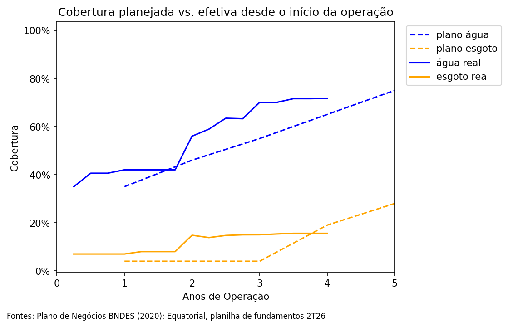
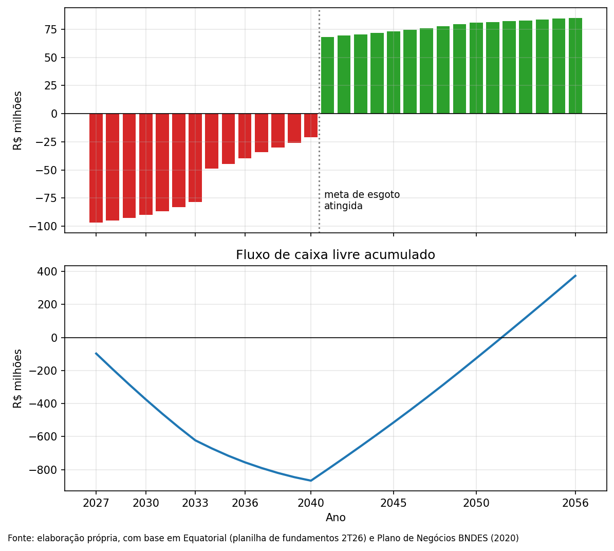
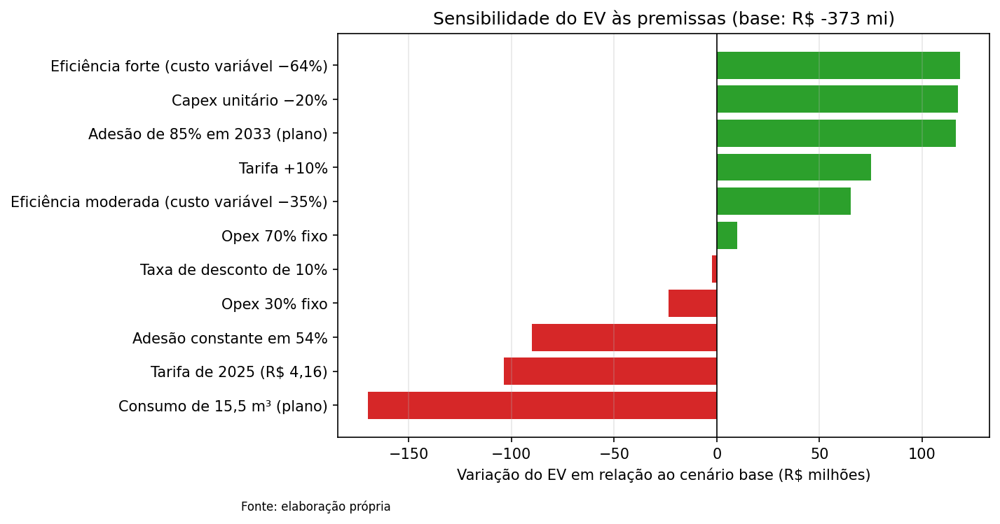

# Valuation da CSA: concessão de água e esgoto do Amapá

**A que preço um investidor de infraestrutura deveria comprar a CSA?**

A Concessionária de Saneamento do Amapá (CSA), controlada pela Equatorial, venceu em 2021 o leilão da concessão de água e esgoto do estado, um dos com menor cobertura do Brasil. Em 2025, a imprensa noticiou que a Equatorial havia colocado a empresa à venda; a venda não foi concluída. Este projeto constrói, com dados públicos, um modelo de fluxo de caixa descontado para entender por quê.

## Principais conclusões

- **Cobertura mede rede, não clientes.** Pelo contrato, o índice de cobertura conta as economias *em condições* de se ligar. Só 54% delas são clientes ativos, e apenas 1 em cada 4 domicílios que ganharam rede desde 2022 passou a pagar. As economias ativas caem desde o 2T25.
- **A concessão se paga, mas rende pouco.** O fluxo de caixa acumulado só fica positivo em 2052, e a TIR real é de 2,1%, abaixo do custo da própria dívida (6,8%). A 15% real, o enterprise value é de −R$ 373 milhões.
- **O problema dominante é a dívida.** Mesmo no cenário otimista, com quatro alavancas de turnaround combinadas, o equity fica em −R$ 1,4 bilhão. A dívida de R$ 1,4 bilhão é várias vezes maior que o valor da operação.
- **A própria controladora avalia a CSA com premissas mais otimistas.** A Equatorial calculou o valor da CSA em R$ 947 milhões no teste de impairment de 2025; a diferença para este modelo se concentra em adesão e custo operacional. A dívida é garantida pela Equatorial, o que ajuda a explicar a venda não concluída.

**Sem reestruturar a dívida, a CSA não vale a compra; com a dívida reestruturada, o valor depende inteiramente da execução do turnaround.**

## Estrutura do notebook

1. **Contexto:** seleção do caso a partir de dados do SINISA e do IBGE
2. **Diagnóstico:** cobertura planejada (plano BNDES) vs. efetiva
3. **Premissas:** premissas documentadas, calibração com dados reais e a separação entre universo, cobertura e adesão
4. **Projeção (2027-2056):** receita, custos, investimentos e fluxo de caixa livre
5. **Valuation:** enterprise value, equity value e TIR
6. **Cenários:** sensibilidade a cada premissa e cenários combinados
7. **Conclusão**

## Fontes de dados

| Fonte | Uso |
|---|---|
| Equatorial, planilha de fundamentos 2T26 | Dados operacionais e financeiros da CSA |
| Plano de Negócios referencial do BNDES (PwC, 2020) | Premissas de adesão, consumo, capex e metas |
| Contrato de concessão e anexos | Definição dos indicadores e estrutura tarifária |
| IBGE (estimativas 2026 e Censo 2010) | População e urbanização |
| SINISA 2024 | Indicadores de esgoto por município |

Todas as premissas estão em `dados/premissas_csa.xlsx`, com fonte e página. O notebook lê os dados direto deste repositório e roda do início ao fim no Colab.

## Limitações

Modelo construído apenas com dados públicos. A divisão do opex entre custo fixo e variável e a adesão do cenário base são premissas próprias. Não houve acesso aos contratos de dívida, às garantias nem ao cadastro comercial da empresa.

## Ferramentas

Python (pandas, numpy, numpy-financial, matplotlib) no Google Colab.
